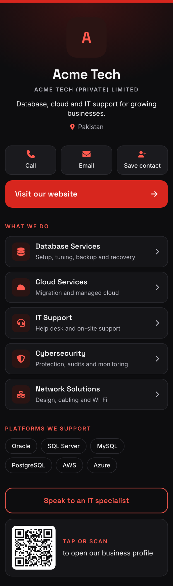

# Linkfolio

A self-hosted "link in bio" and digital business card app. Each person claims `yoursite.com/username`, adds
links and contact details, styles the page, and sees views and clicks. It powers the profile pages behind
[OneTap](https://onetap-site-weld.vercel.app) NFC cards, so it's built to open fast on a phone after a tap
or a QR scan.

Built with Next.js 15 (App Router, TypeScript), Tailwind CSS v4, and SQLite via Drizzle ORM. No outside
services are needed to run it locally.

[](https://vercel.com/new/clone?repository-url=https%3A%2F%2Fgithub.com%2FMuhammadAbdullahHasan%2Flinktree-clone&env=INVITE_CODE&envDescription=Code%20people%20need%20to%20sign%20up.%20Leave%20empty%20for%20open%20sign-ups.&project-name=linkfolio)



## Features

- **Two page styles.** A profile card with link tiles for people, and a business page for companies
  (quick actions, services with subtitles, platform chips, a call-to-action and a tap-or-scan QR card).
- **Contact actions.** Call, WhatsApp, email and a "Save contact" button that downloads a vCard.
- **Appearance editor with a live preview.** Presets, colours, gradients, background and cover photos,
  button shapes, fonts and a floating dock.
- **Analytics.** Page views and per-link clicks (every link goes through `/go/<id>` so clicks are counted).
- **Managed profiles.** One admin can run pages for customers who never log in, and hand out short-lived
  edit links.
- **Small and private.** Your own database, your own auth, no trackers, no third-party accounts needed.

## Run it locally

```bash
npm install
cp .env.example .env.local   # then set INVITE_CODE
npm run db:migrate           # creates data/linkfolio.db
npm run dev                  # http://localhost:3000
```

All data lives in `data/linkfolio.db`, a single file. Back it up by copying it. `npm run db:studio` opens a
browser view of the tables.

## Put it online (Vercel + Turso)

Vercel can't keep a database file, so the online copy uses [Turso](https://turso.tech), which hosts the
same kind of SQLite database (free tier).

1. Import this GitHub repo as a new project in Vercel.
2. In the project, open **Storage → Create Database → Turso** and connect it. That sets
   `TURSO_DATABASE_URL` and `TURSO_AUTH_TOKEN` for you.
3. Add an `INVITE_CODE` environment variable, then redeploy.

Each deploy creates or updates the tables (`vercel-build` runs `drizzle-kit migrate` first). The site
address is detected automatically; set `NEXT_PUBLIC_SITE_URL` only if you add a custom domain.

## How accounts and security work

- Passwords are hashed with scrypt; the plain password is never stored.
- Sign-in creates a random session token in an httpOnly cookie. The database stores only its SHA-256
  hash, so a leaked database can't be used to log in. Sessions last 30 days and extend while in use.
- Repeated wrong passwords are blocked for 15 minutes (10 per account, 30 per IP address).
- Sign-up needs `INVITE_CODE` when it's set. Leave it empty to allow anyone to sign up.
- Every write in `src/app/dashboard/actions.ts` is scoped to the signed-in user's id, so people can only
  change their own pages.
- There is no email sending, so there's no "forgot password". To reset someone's password, delete their
  row in `users` (with `npm run db:studio`) and let them sign up again.

## Where things live

| Path | What it is |
| --- | --- |
| `src/db/schema.ts` | Database tables; run `npm run db:generate` after changing it, then `npm run db:migrate` |
| `src/lib/auth.ts` | Password hashing, sessions, rate limiting |
| `src/app/(auth)/actions.ts` | Sign up, sign in, sign out |
| `src/app/dashboard/actions.ts` | Everything the dashboard saves |
| `src/app/[username]` | Public profile page |
| `src/app/go/[linkId]` | Counts a click, then redirects to the link |
| `src/app/avatar/[userId]` | Serves profile photos (stored in the database, resized in the browser first) |
| `src/components/ProfilePage.tsx` | Renders a profile; shared by the public page and the live preview |
| `src/lib/themes.ts`, `src/lib/socials.tsx` | Theme presets and supported social platforms |
| `src/lib/config.ts` | App name |
